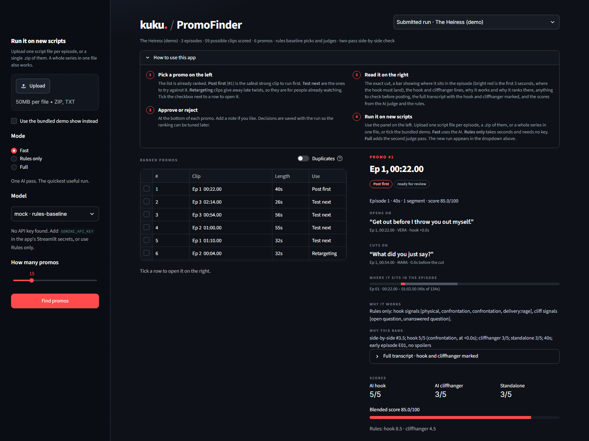

# Promo Finder (Kuku AI Generalist assignment, Problem 1)

Reads microdrama screenplays and finds 20-60 s promo clips: hook in the first 3 s, cut on a cliffhanger,
understandable without the rest of the show. Gives ranked picks with exact timestamps, then an editor approves them.



## Run it

```bash
python processor.py --input "path/to/scripts.zip" --provider mock          # offline rules baseline, no key
cp .env.example .env    # add GEMINI_API_KEY (free) or GROQ_API_KEY (free)
python processor.py --input "path/to/scripts.zip" --provider gemini --out outputs/gemini_run
python processor.py --input "path/to/scripts.zip" --provider anthropic --model claude-sonnet-5-5
python -m unittest discover -s tests -v                                     # rule tests
pip install -r requirements.txt && streamlit run app.py                     # editor review UI
```

Input can be a `.zip`, a folder of `.txt` files or a single `.txt`. The pipeline needs only Python 3.10+
and no packages. Reruns read from `.llm_cache/`, so the same input, model and prompt give the same
output at no cost. Use `--no-cache` to call the model again.

## Deploy on Streamlit Community Cloud

The review UI is a standard Streamlit app (`app.py`), so the repo deploys as-is:

[](https://share.streamlit.io/deploy?repository=tausnix/kuku-promo-finder&branch=main&mainModule=app.py)

1. Sign in at [share.streamlit.io](https://share.streamlit.io) with GitHub, then pick
   `tausnix/kuku-promo-finder`, branch `main`, main file `app.py` (the button above pre-fills this).
2. Open **App settings -> Secrets** and paste the key for one provider (see
   `.streamlit/secrets.toml.example`):
   ```toml
   GEMINI_API_KEY = "your-key"
   ```
3. Deploy. With no key the app still runs: the sidebar defaults to the offline `mock` rules baseline.

`demo/` holds a small synthetic run so the review screen is populated on first load.
Streamlit Cloud storage is ephemeral: runs started in the app, and editor decisions, reset on redeploy.

## Who does what

| Step | Owner | File |
|---|---|---|
| Parse script into time-coded blocks with stable IDs (`E07-031`) | **Code** | `parser.py` |
| Keyword/emotion scan for hook and cliffhanger signals | **Code** | `signals.py` |
| Build prompt: lines with IDs, rule hints, next-episode opening | **Code** | `prompts.py` |
| Judge what is gripping and pick start/end **line IDs**, hook, cliffhanger, why, 1-5 scores | **LLM** | `llm_client.py` |
| Map IDs to timestamps, snap to camera cuts, enforce every rule | **Code** | `validator.py` |
| Send rule violations back to the model once to fix | **LLM** (driven by code) | `processor.py` |
| Score, de-duplicate, order "post first" list | **Code** | `ranker.py` |
| Order the top 20 side by side (2 passes, second reversed); blended 50/50 with the score order | **LLM**, checked by code | `reranker.py` |
| Quality report: funnel, rejection reasons, possible misses | **Code** | `evaluator.py` |
| Approve / reject with reason / set post order, export gold set | **Human** | `app.py` |

The model only judges taste. Anything that can be measured is measured in Python.

## Deterministic rules

Before the LLM call:
1. Every block (dialogue, action, SFX, camera) gets an ID tied to its parsed `Start`/`End`. The model only ever sees and returns IDs.
2. Camera lines are left out of the prompt to halve tokens. They're kept for snapping cut points.
3. Only the current episode plus the first 30 s of the next one are allowed, so a cliffhanger can carry over into the next episode.
4. A keyword scan flags likely hooks and cliffhangers as hints. The prompt marks them as "often wrong".

After the LLM call (an error rejects the promo, a warning sends it to the editor):

| Rule | Type |
|---|---|
| Reply is a JSON object with a `promos` list (fences/prose stripped, nothing else repaired) | error |
| Every `start_id`/`end_id`/`hook_id`/`cliffhanger_id` exists in the parsed script | error |
| IDs belong to the current or next episode; a segment stays inside one episode | error |
| 1-4 segments, chronological, non-overlapping; end not before start | error |
| Total runtime (computed from script, after snapping) is 20-60 s | error |
| Hook line is in the first segment and starts ≤ 3 s after the clip start | error |
| Cliffhanger line is in the last segment and ends ≤ 6 s before the clip end | error |
| `hook_quote` / `cliffhanger_quote` appear verbatim in that line (normalized for case, quotes, whitespace) | error |
| Scores are integers 1-5 | error |
| Cut points snap to the camera shot boundary if within 1.5 s | repair |
| More promos than the per-episode cap are dropped | repair |
| Hook line has no keyword/emotion signal | warning |
| Hook line is a reply or half-sentence ("...and", "Because", "Worry?"); the error names the line to start on | error |
| Standalone ≤ 2, or the model states missing context | warning |
| Cross-episode or multi-segment clip | warning |
| Two promos share > 50 % of runtime: keep the stronger opening (complete line, hook score), then higher score | dedupe |
| Top 10 holds at most 2 promos per episode | ranking |
| Side-by-side reply must be a permutation of the given IDs (unknown dropped, missing keep their place, < half valid = pass ignored, no usable pass = score order stands) | error / fallback |

Errors go back to the model once, quoted exactly (e.g. `duration_too_long: total 74.3s > 60s - move end_id earlier`).
Anything still failing goes to `rejected.json` with its reasons.

The output never shows the model's quote. Hook and cliffhanger text are always the parser's `script_text`.

## Swapping models

`llm_client.py` defines one interface, `LLMClient.generate(system, user) -> LLMResponse`. Providers:
`gemini`, `groq`, `huggingface` (Inference Providers router), `openai`, `anthropic`, `ollama` (local), `mock` (offline rules). Pick one with `--provider` / `--model`
or `LLM_PROVIDER` / `LLM_MODEL`. Any OpenAI-compatible API is a 4-line subclass of `OpenAICompatibleClient`.
Retries with backoff on 429/5xx, rate-limits free tiers and caches responses on disk.
Default model names are in each class. Check them against the provider's current model list.

## Outputs (`outputs/<run>/`)

`promos_ranked.json` (everything), `promos_ranked.csv`, `promos_ranked.md` (readable report), `quality_report.md`,
`rejected.json`, `llm_calls.json`, `episodes_parsed.json`, `run_meta.json` (provider, model, prompt version, config),
`raw/` (every prompt and unedited model response), `review.json` (editor decisions from the app).

## Measuring quality

- `quality_report.md` lists, per run: validation funnel, hallucinated IDs and invented quotes caught, rejection reasons,
  duration and hook-offset stats, episodes with no promo, **LLM picks with no rule signal** (possible over-rating) and
  **strong rule hooks no promo covers** (possible misses).
- The editor's approvals export as `gold.csv`. `python evaluator.py --run outputs/x --gold gold.csv` gives precision,
  precision@10 and recall for a new model or prompt.
- `--provider mock` is the rules-only baseline any LLM should beat.

## Confidentiality

The input pack is Kuku's and confidential, so this repo holds code only. `.gitignore` excludes the scripts
(`.zip`, `data/`), every run's outputs (`outputs/`: promos quote the script) and the LLM cache. Raw outputs
are shared through the private submission link. Tests use made-up dialogue; `demo/` is synthetic too and
safe to publish.
